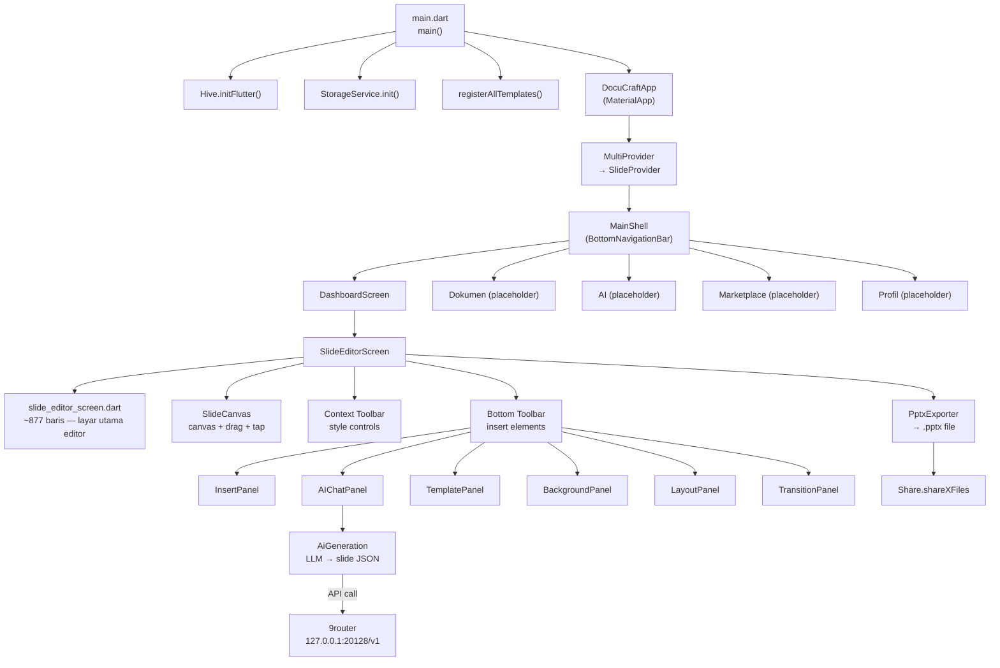
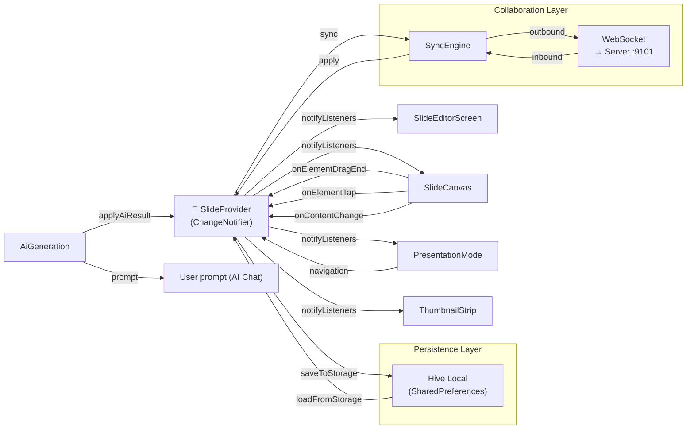
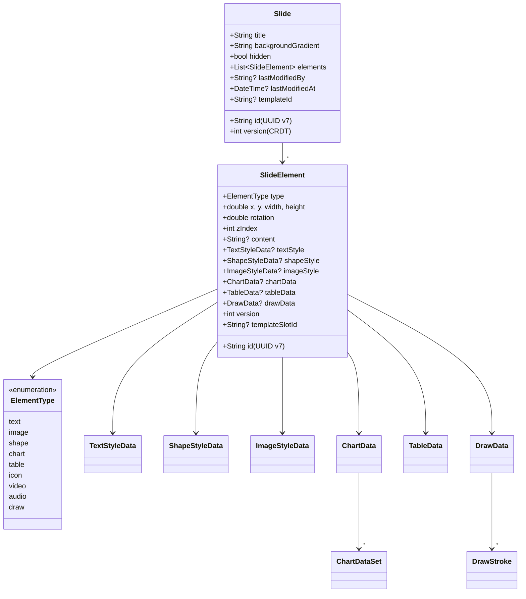

# 🗺️ DocuCraft App — Project Mapping Report

> **Tanggal**: 28 Juli 2026
> **Project**: `docucraft_app` — Mobile PPT Editor with AI & Collaboration
> **Stack**: Flutter / Dart 3.13+ | Provider | Hive | WebSocket (collab) | 9router LLM
> **Total**: 39 Dart files · ~13,480 baris kode · 8 direktori di `lib/`

---

## 1. Ringkasan Project

**DocuCraft** adalah aplikasi editor presentasi (PPT) berbasis Flutter yang menyasar:
- **Mobile-first**: UI touch-friendly, bottom sheets, floating toolbar
- **AI-powered**: Generate slide via LLM (9router endpoint)
- **Collab-ready**: WebSocket real-time sync dengan conflict resolution LWW (Last-Writer-Wins)
- **Export**: .pptx (Office Open XML) via XML builder + archive library

Target platform: **Android, iOS, Web** (build/web/ ada, tapi ada `dart:io` di export — risk of web breakage)

---

## 2. Diagram Struktur Folder

```
docucraft_app/
├── lib/                          # 🎯 Source utama (13.5K baris)
│   ├── main.dart                 # Entry point + CollabManager + App shell + BottomNav
│   ├── models/                   # Struktur data / domain models
│   │   ├── slide.dart            # Slide + SlideElement + 6 style types (694 baris)
│   │   ├── template.dart         # Template model (397 baris)
│   │   └── template_registry.dart# Daftar semua template built-in (509 baris)
│   ├── providers/
│   │   └── slide_provider.dart   # State management utama + undo/redo (655 baris)
│   ├── screens/                  # Halaman utama
│   │   ├── dashboard_screen.dart       # Home: greeting, quick actions, recent docs (223 baris)
│   │   ├── slide_editor_screen.dart    # Editor utama paling kompleks (877 baris)
│   │   └── template_browser.dart       # Browse + preview template (268 baris)
│   ├── services/                 # Business logic & external integrations
│   │   ├── ai_generation.dart    # LLM client → slide generation (576 baris)
│   │   ├── api_client.dart       # REST API client (232 baris)
│   │   ├── pptx_export.dart      # .pptx export → XML builder (554 baris)
│   │   ├── pptx_import.dart      # .pptx importer (289 baris — tapi belum di-wire)
│   │   ├── storage_service.dart  # Hive local persistence (76 baris)
│   │   └── template_engine.dart  # Template rendering engine (261 baris)
│   ├── collab/                   # Real-time collaboration
│   │   ├── collab_web_socket_provider.dart  # WS client (339 baris)
│   │   ├── sync_engine.dart      # Jembatan local ↔ remote (295 baris)
│   │   ├── conflict_resolver.dart# LWW conflict resolution (166 baris)
│   │   ├── offline_queue.dart    # Pending changes offline (260 baris)
│   │   └── presence.dart         # Cursor/selection presence (100 baris)
│   ├── themes/
│   │   └── app_theme.dart        # Dark theme + color constants (103 baris)
│   └── widgets/                  # 18 widget reusable
│       ├── presentation_mode.dart      # ⭐ Fullscreen present mode (1.1K baris)
│       ├── slide_canvas.dart           # Canvas editor + drag + resize (483 baris)
│       ├── ai_chat_panel.dart          # AI chat bottom sheet (389 baris)
│       ├── draw_canvas.dart            # Drawing canvas (391 baris)
│       ├── text_editor_bottom_sheet.dart# Rich text editing (521 baris)
│       ├── image_editor.dart           # Image edit controls (384 baris)
│       ├── template_panel.dart         # Template picker (332 baris)
│       ├── comments_panel.dart         # Comment system (330 baris)
│       ├── background_panel.dart       # Background gradient picker (307 baris)
│       ├── insert_panel.dart           # Insert element panel (205 baris)
│       ├── grid_view.dart              # Grid view mode (278 baris)
│       ├── color_picker_dialog.dart    # Color picker (356 baris)
│       ├── layout_panel.dart           # Layout presets (141 baris)
│       ├── transition_panel.dart       # Slide transitions (166 baris)
│       ├── search_panel.dart           # Slide search (231 baris)
│       ├── presence_overlay.dart       # Collab presence avatars (449 baris)
│       ├── slide_thumbnail_strip.dart  # Slide thumbnails strip (141 baris)
│       ├── version_history.dart        # Version history (129 baris)
│       └── element_comments.dart       # Per-element comments (129 baris)
│
├── server/
│   └── collab_server.dart       # WebSocket collab server (Dart/shelf)
│
├── web/                          # Flutter Web entry
│   ├── index.html
│   ├── manifest.json
│   └── favicon.png
│
├── presenton-templates/          # Template preset files (TSX/TS)
│   ├── Code/, Education/, ProductOverview/, Report/
│   ├── modern/, standard/, swift/, neo-*/
│   └── index.tsx + defaultSchemes.ts
│
├── assets/                       # App assets
│   └── icons/
│
├── build/web/                    # Web build output
├── android/ + ios/               # Native platform config
└── test/                         # Unit tests
```

---

## 3. Diagram Arsitektur & Alur Code

### 3.1. Alur Eksekusi Utama



### 3.2. State Management & Data Flow



### 3.3. Struktur Model Data



### 3.4. Relasi Antar Modul

```mermaid
flowchart TD
    subgraph "Screens"
        DASH["DashboardScreen"]
        EDITOR["SlideEditorScreen"]
        TMPLB["TemplateBrowser"]
    end
    
    subgraph "Widgets"
        CANVAS["SlideCanvas"]
        PRES["PresentationMode"]
        AI_CHAT["AIChatPanel"]
        DRAW["DrawCanvas"]
        TMPLP["TemplatePanel"]
        INSERT["InsertPanel"]
        BG["BackgroundPanel"]
        LAYOUT["LayoutPanel"]
        TRANS["TransitionPanel"]
        COMM["CommentsPanel"]
        SEARCH["SearchPanel"]
        VER["VersionHistory"]
        PRESOVER["PresenceOverlay"]
        IMGED["ImageEditor"]
        TXTED["TextEditorBottomSheet"]
        CLRPK["ColorPickerDialog"]
        GRID["GridView"]
        THUMB["SlideThumbnailStrip"]
        ELCOMM["ElementComments"]
    end
    
    subgraph "Providers"
        PROV["SlideProvider"]
    end
    
    subgraph "Models"
        SLIDE["Slide + SlideElement"]
        TMPL["Template"]
        TMPLR["TemplateRegistry"]
    end
    
    subgraph "Services"
        AI["AiGeneration"]
        API["ApiClient"]
        EXP["PptxExporter"]
        IMP["PptxImporter"]
        STOR["StorageService"]
        TMPLE["TemplateEngine"]
    end
    
    subgraph "Collab"
        COLLABWS["CollabWebSocketProvider"]
        SYNC["SyncEngine"]
        CONFLICT["ConflictResolver"]
        OFFLINE["OfflineQueue"]
        PRESENCE["Presence"]
    end
    
    %% Dependencies
    EDITOR --> CANVAS
    EDITOR --> PRES
    EDITOR --> AI_CHAT
    EDITOR --> TMPLP
    EDITOR --> INSERT
    EDITOR --> BG
    EDITOR --> LAYOUT
    EDITOR --> TRANS
    EDITOR --> SEARCH
    EDITOR --> VER
    EDITOR --> PRESOVER
    EDITOR --> IMGED
    EDITOR --> TXTED
    EDITOR --> CLRPK
    EDITOR --> GRID
    EDITOR --> THUMB
    EDITOR --> DRAW
    EDITOR --> COMM
    EDITOR --> ELCOMM
    
    EDITOR --> PROV
    EDITOR --> EXP
    
    CANVAS --> SLIDE
    PRES --> PROV
    AI_CHAT --> AI
    
    PROV --> SLIDE
    PROV --> STOR
    
    AI --> SLIDE
    
    EXP --> SLIDE
    IMP --> SLIDE
    
    TMPLP --> TMPL
    TMPLP --> TMPLR
    TMPLB --> TMPLR
    
    TMPLE --> SLIDE
    TMPLE --> TMPL
    
    COLLABWS --> SYNC
    SYNC --> PROV
    SYNC --> PRESENCE
    SYNC --> OFFLINE
    SYNC --> CONFLICT
```



---

## 4. Arsitektur & Pola yang Terdeteksi

### ✅ Pola Arsitektur: **Layered + Provider-Driven**

| Layer | Direktori | Tanggung Jawab |
|-------|-----------|----------------|
| **Presentation** | `screens/` + `widgets/` | UI rendering, user interaction |
| **State** | `providers/` | ChangeNotifier state management (Provider pattern) |
| **Domain** | `models/` | Data structures, serialization, CRDT metadata |
| **Service** | `services/` | External integrations (AI, export, storage, template) |
| **Network/Collab** | `collab/` | Real-time sync, conflict resolution, presence |

### ✅ Pola Desain yang Teridentifikasi

1. **Provider Pattern** — State management via `ChangeNotifierProvider` + `Consumer`/`context.watch`
2. **Repository-like Services** — `StorageService` abstracts Hive, `ApiClient` abstracts HTTP
3. **Singleton** — `CollabManager` (main.dart), template registry
4. **Snapshot-based Undo/Redo** — Full serialized state snapshots (max 30), bukan command pattern
5. **CRDT Metadata** — `version`, `lastModifiedBy`, `lastModifiedAt` di model
6. **LWW Conflict Resolution** — Last-Writer-Wins per element + per slide
7. **Offline Queue** — Pending changes buffered saat disconnect

### 🌟 Highlights

- **`presentation_mode.dart` (1.1K baris)** — Fitur paling matang: keyboard nav, swipe, speaker notes, progress bar, auto-hide chrome
- **`slide_model.dart` (694 baris)** — Model terstruktur dengan 6 tipe style data, backward compat V1→V2, CRDT metadata
- **`slide_editor_screen.dart` (877 baris)** — Screen paling kompleks dengan ~18 panel/widget terintegrasi
- **Collab server** — Dart/shelf WebSocket server di `server/`, bisa jalan standalone

### ⚠️ Temuan Struktural

| Issue | Detil |
|-------|-------|
| **`dart:io` di web target** | `pptx_export.dart:12` pake `dart:io` → crash di Flutter Web |
| **Orphan code** | `pptx_import.dart` (289 baris functional) — ada kode, gak di-wire ke UI |
| **Placeholder screens** | 4 dari 5 tab BottomNav (Dokumen, AI, Market, Profil) cuma `Center(child: Text(...))` |
| **Callback kosong** | Tombol AI & Word di dashboard, Underline di context toolbar — `() {}` |
| **Resize handles** | `slide_canvas.dart:447` return `[]` — gak ada handles |
| **Template apply minimal** | Cuma ganti background gradient, gak sentuh layout |
| **AI API key default kosong** | `const String.fromEnvironment('AI_API_KEY', defaultValue: '')` |
| **Nama user hardcoded** | 'Rina Amalia' di dashboard |
| **Chart labels truncated** | 4 karakter max (`slide_canvas.dart:388`) |
| **Demo slides fallback** | Selalu nge-reset ke demo kalo storage kosong |

---

## 5. Metrik File

| Rank | File | Lines | Fungsi Utama |
|------|------|-------|-------------|
| 1 | `widgets/presentation_mode.dart` | 1,114 | Fullscreen slide presentation |
| 2 | `screens/slide_editor_screen.dart` | 877 | Main PPT editor |
| 3 | `providers/slide_provider.dart` | 655 | State management + undo/redo |
| 4 | `services/ai_generation.dart` | 576 | AI slide generation |
| 5 | `services/pptx_export.dart` | 554 | PPTX export |
| 6 | `widgets/text_editor_bottom_sheet.dart` | 521 | Rich text editor |
| 7 | `models/template_registry.dart` | 509 | Template definitions |
| 8 | `widgets/slide_canvas.dart` | 483 | Canvas + drag |
| 9 | `widgets/presence_overlay.dart` | 449 | Collab presence |
| 10 | `models/slide.dart` | 694 | Data models |

**Total**: 39 files · 13,480 baris · rata-rata ~346 baris/file

---

## 6. Potensi Perbaikan

### 🔴 Critical
1. **AI harus jalan out-of-the-box** — API key wizard atau fallback offline
2. **Web export fix** — `dart:io` → conditional import
3. **Resize handles** — MVP tanpa ini = sticker board, bukan editor PPT

### 🟡 Signifikan
4. **Wire up PPTX Importer** — kode sudah ada, tinggal sambung ke UI
5. **Template layout engine** — apply template harus ubah layout, bukan cuma background
6. **Loading states** — export, AI generation, collab sync perlu spinner/overlay
7. **Copy-paste UX** — gak mutasi objek sebelum add, support multiple paste

### 🟢 Minor
8. Hapus placeholder screens atau isi konten
9. Ganti nama user hardcoded jadi dinamis
10. Chart label truncation 4 karakter → terlalu agresif
